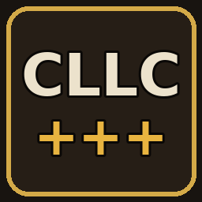

# CLLC Extended



A Valheim add-on for [Creature Level & Loot Control](https://valheim.hexium.gg/mods/Smoothbrain/CreatureLevelAndLootControl)
(CLLC): creature inspection, per-star colours, a star counter and 24 combat modifiers adapted from
CreatureManager. Published on Hexium as `Elliog-CLLC_Extended`.

> **Young project, use at your own risk.** The code was written with an AI coding assistant
> (Claude), directed and play-tested by its author on a private server. Expect bugs and back up your
> world. Please report issues here with your `BepInEx/LogOutput.log`.

Player documentation (features, installation, compatibility, configuration):
[`package/README.md`](package/README.md), also shown on Hexium.

## Build

Requirements: the .NET SDK (8 or later) and the assemblies of a Valheim install with BepInEx, which
cannot be redistributed. Either copy them under `refs/` (git-ignored):

```text
refs/
  BepInEx/core/            BepInEx.dll, 0Harmony.dll
  valheim_Data/Managed/    assembly_valheim.dll, assembly_utils.dll, assembly_guiutils.dll,
                           UnityEngine*.dll, Unity.TextMeshPro.dll
```

(a dedicated server's `valheim_server_Data/Managed/` works too), or point the build at them:

```bash
dotnet build -c Release -p:ValheimDir="/path/to/Valheim" -p:BepInExDir="/path/to/profile/BepInEx"
```

`scripts/package.sh` builds with warnings as errors, checks that `PluginInfo.cs` and
`package/manifest.json` have the same version, and writes `dist/Elliog-CLLC_Extended-<version>.zip`,
the format Hexium and Thunderstore expect. It passes its arguments to `dotnet build`.

To release: bump `PluginInfo.Version` and `package/manifest.json` (ServerSync then requires every
player to update), add a `package/CHANGELOG.md` entry, run the script, upload the zip on Hexium.

## Layout

| Path | Responsibility |
|---|---|
| `CllcExtendedPlugin.cs` | Entry point (hard dependency on CLLC): Harmony patches, console commands, inspect key |
| `ConfigBinder.cs` | Binds entries and registers them with ServerSync (version check, synced or local) |
| `PluginConfig.cs` | Every setting, in numbered sections (`1 - General` ... `5 - Modifier chances`); `6 - Modifier values` is bound by each modifier class through `Modifiers/ModifierValues.cs` |
| `Loc.cs` | French / English texts (config or game language) |
| `Inspection/` | Game-independent model (`DamageProfile`, `CreatureInsight`), reader and formatting |
| `Integration/` | CLLC bridge (reflection on its public `API`) and the translation of its effects into traits |
| `Modifiers/` | Catalog (texts, groups, chances), ZDO storage, roll, behaviours by theme, icons, status effects |
| `Ui/` | Nameplate (name words, star counter, modifier icons, EpicMMO label, inspection lines), star colours, chat output, `cllcx_hud` dump |
| `package/` | Hexium/Thunderstore package files |
| `Vendor/ServerSync/` | ServerSync source (MIT-0), unchanged |

## Implementation notes

- **Where things run.** Modifiers are rolled in `Character.Start` / `Humanoid.Start` on the owner,
  after CLLC set the level, and stored on the ZDO (`cllcx.modifiers`) so every client sees them.
  Hits leaving a creature are changed on its owner (`Character.Damage`), hits arriving on the
  target's owner (`Character.RPC_Damage`, `Character.ApplyDamage`), AI-driven modifiers on the
  creature's owner (`MonsterAI.UpdateAI`), death effects on the owner of the dead
  (`Character.CheckDeath`, state captured just before: the creature's ZDO is destroyed during it).
  Visual effects use vanilla prefabs, broadcast through per-creature RPCs.
- **Inspection.** Damage values combine the vanilla damage modifiers (armor and status effects
  included) with what CLLC changes at hit time: infusions, Armored and the Sturdy/Godlike boss
  affixes. Boss affix powers are read from the CLLC config; creature effect powers use CLLC
  defaults (they can only be changed in CLLC's creature YAML). CLLC is a soft dependency.
- **Versions and config sync.** Same approach as CLLC and the other Smoothbrain mods: ServerSync
  (`ConfigSync` with `CurrentVersion = MinimumRequiredVersion = PluginInfo.Version`, plus
  `ModRequired`) refuses players without the mod or with another version. Gameplay sections (4-6)
  are synced while `Lock Configuration` is on; display, language and keys are local. Settings also
  carry `scm:live` / `scm:relog` tags for Ultimate Server Configuration Manager.
- **Tests.** Like CLLC's author's public mods (Jewelcrafting has no test project), quality rests on
  a warnings-as-errors build and in-game testing; `scripts/package.sh` checks that the plugin
  and package versions match.
- **No hard-coded tuning.** Every modifier value is a config entry declared next to the code using
  it (CreatureManager's defaults). Remaining constants are vanilla prefab names, RPC/ZDO keys, HUD
  layout sizes, and CLLC's own hit-time numbers, which the inspection must mirror.
- **Names.** French adjectives follow the creature name and agree with it (same feminine creatures
  as CLLC's French translation); English adjectives go before it, like CLLC's English format.


## Licensing

GPL-3.0 (see `LICENSE`). Combat modifiers follow CreatureManager by sighsorry
(https://github.com/sighsorry1029/CreatureManager, GPL-3.0): its modifier list, rules and default
values; the modifier icons and their decoder are ported from its `ModifierIconSource.cs`, and the
star background from its five-point star test. Star colours come from StarLevelSystem by
MidnightsFX (GPL-3.0): its default per-level palette and its colouring approach. CLLC is closed
source: only its public API is called, and the damage it changes at hit time is reimplemented for
display only (numbers from CLLC 5.0.7). ServerSync by blaxxun is vendored under MIT-0.
